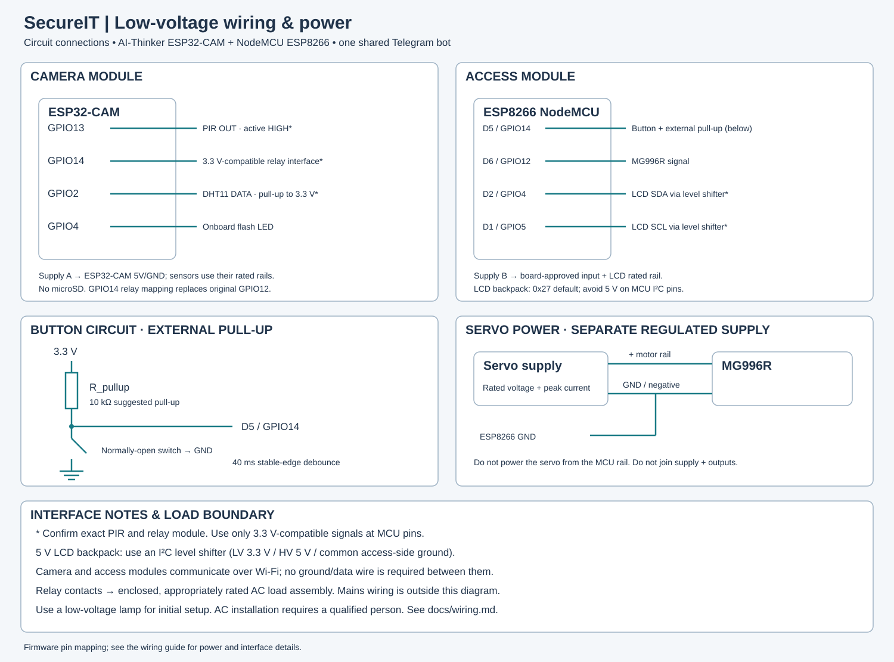
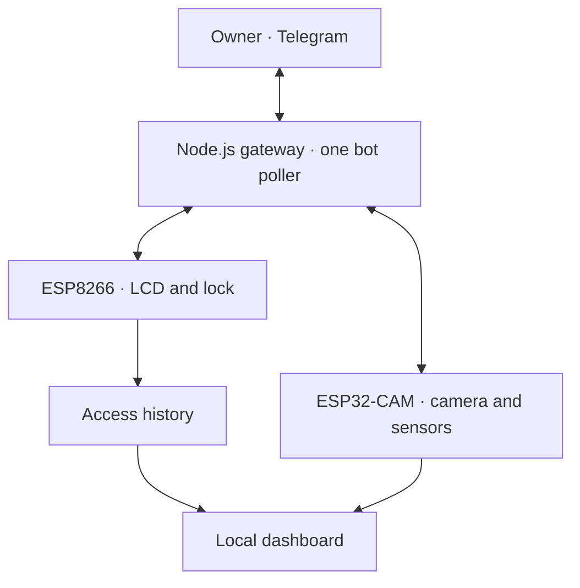

# SecureIT

**Telegram-controlled surveillance and access control using ESP32-CAM and ESP8266.**

SecureIT combines camera monitoring, motion-triggered photos, environmental readings, remote lighting, and an LCD number challenge for a servo-operated lock. A local dashboard places timestamped access history beside the live camera feed.

A hackathon project combining surveillance and access control, with a single Telegram bot gateway. See [CHANGELOG.md](CHANGELOG.md) for the software structure and configuration.

## Features

- Telegram photos, with or without the ESP32-CAM flash.
- PIR-triggered photo alerts with enable/disable controls and a cooldown.
- DHT11 temperature and humidity readings.
- Relay control for the lighting circuit.
- Button-triggered, three-choice LCD number challenge.
- Owner-only Telegram controls, one-use challenge IDs and expiry.
- MG996R servo unlock action with automatic return after five seconds.
- Browser dashboard with logs on the left and livestream on the right.
- File-backed history of the latest 100 granted/denied decisions.

## How it works

The ESP8266 displays a random three-digit number after a debounced button press. The gateway sends three distinct choices to the owner’s Telegram chat. A matching selection instructs the board to move the servo; a nonmatching selection displays Access Denied. A consumed or expired challenge cannot operate the lock again.

The ESP32-CAM handles images, PIR input, DHT11 readings and relay control. Video uses a separate HTTP server on port 81 so a stream does not occupy the main command-processing loop. Camera access is serialized to coordinate still photos and video.

**One Telegram bot is used.** Only the Node.js gateway polls incoming Telegram updates; neither board polls the bot. Both boards and the gateway must be on the same reachable local network. Telegram photo/control messages need Internet access; the livestream URL needs access to that LAN or a VPN.

## Repository contents

| Path | Purpose |
| --- | --- |
| `firmware/camera/` | AI-Thinker ESP32-CAM PlatformIO project |
| `firmware/access/` | NodeMCU ESP8266 PlatformIO project |
| `gateway/` | Telegram gateway, local dashboard and automated checks |
| `docs/wiring.md` | Pin mapping, button circuit and power guidance |
| `docs/wiring.svg` | Editable wiring diagram |
| `docs/SETUP.md` | Start-to-finish setup |
| `docs/PUBLISH.md` | Public repository publishing steps |
| `docs/PROJECT.md` | Hardware list, scope and portfolio description |
| `docs/TESTING.md` | Software checks and integration procedure |

## Quick start

1. Install Node.js 22+ and PlatformIO (VS Code extension or CLI).
2. Copy each board’s `src/config.example.h` to `src/config.h` and configure Wi-Fi, gateway address and shared key.
3. Build/upload each board using its own PlatformIO folder. Read its IP address in Serial Monitor at 115200 baud.
4. Reserve those addresses in your router’s DHCP settings.
5. In `gateway/`, copy `.env.example` to `.env`. Set the bot token, private owner chat/user IDs, both board addresses and shared key.
6. Run `npm start` from `gateway/`. No npm dependency installation is needed; this server uses Node’s built-in modules.
7. Open the configured dashboard URL and send `/start` to the bot.

See [full setup](docs/SETUP.md) before wiring or uploading.

## Telegram controls

| Command | Action |
| --- | --- |
| `/start`, `/help` | Show control keyboard |
| `/photo` | Send still photo |
| `/photoWithFlash` | Send flash photo |
| `/lightOn`, `/lightOff` | Set relay output |
| `/temperature`, `/temp` | Send temperature and humidity |
| `/motionOn`, `/motionOff` | Enable/disable PIR photo alerts |
| `/stream` | Send local stream and dashboard links |

Access-number choices appear as inline buttons after the physical button is pressed. Motion alerts start disabled after a camera reboot. Relay output starts off; the servo initializes to the configured locked position.

## Wiring and usage

- Power the MG996R from its own regulated supply, within its specified voltage range, with sufficient peak current capacity. Never power it from an MCU GPIO or its 3.3 V rail.
- The button uses an **external pull-up to 3.3 V** and a switch to ground, plus software debounce.
- Use an I²C level shifter when a 5 V LCD backpack pulls SDA/SCL up to 5 V.
- This is a hackathon access-control prototype. Three choices give a random guess a one-in-three chance; matching the LCD number is an owner approval interaction, not a high-security authentication mechanism. Servo position feedback and door-position sensing are not included.
- The dashboard and live stream are designed for a trusted LAN. Do not port-forward them or the board APIs to the Internet. Public source code does not require public camera access.
- The original demonstration used an AC bulb through a relay. The included diagram covers the low-voltage side; mains switching belongs in an appropriately rated, insulated enclosure and must be handled by a qualified person. Use a low-voltage load for initial integration.

## Credits and reuse

Hackathon work: **Ibrahim Mallick**. Shared project source: [kaunain3/SecureIT](https://github.com/kaunain3/SecureIT), baseline commit `3569c58`. Additional contributors can be credited here.

An open-source license has not been selected. Confirm ownership of shared project code and choose a license before granting redistribution rights. Dependency licenses remain with their respective authors.
